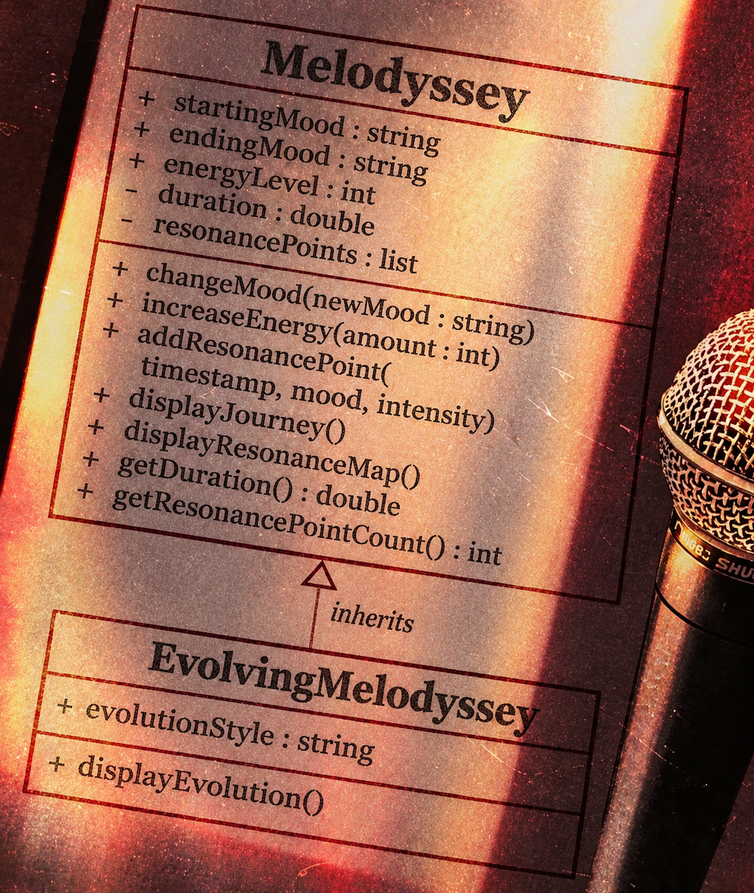
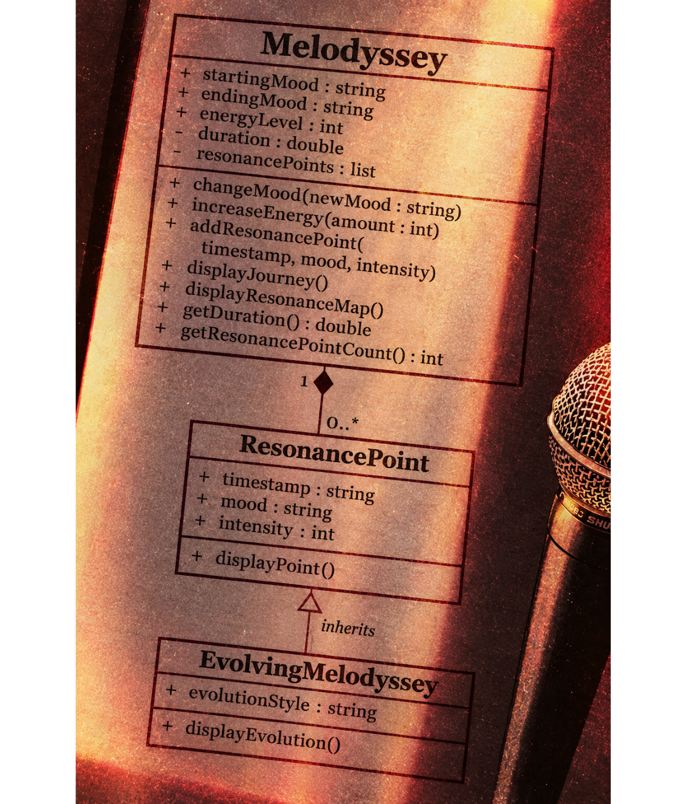
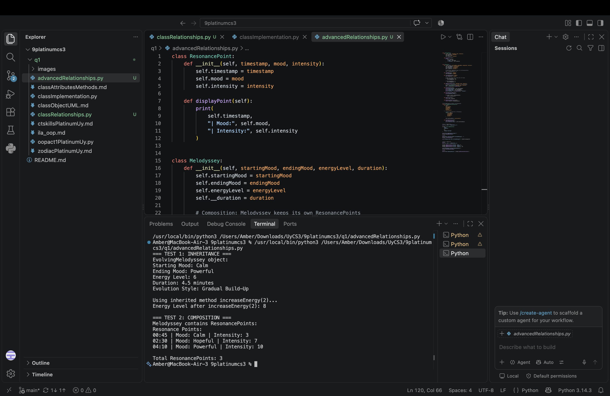
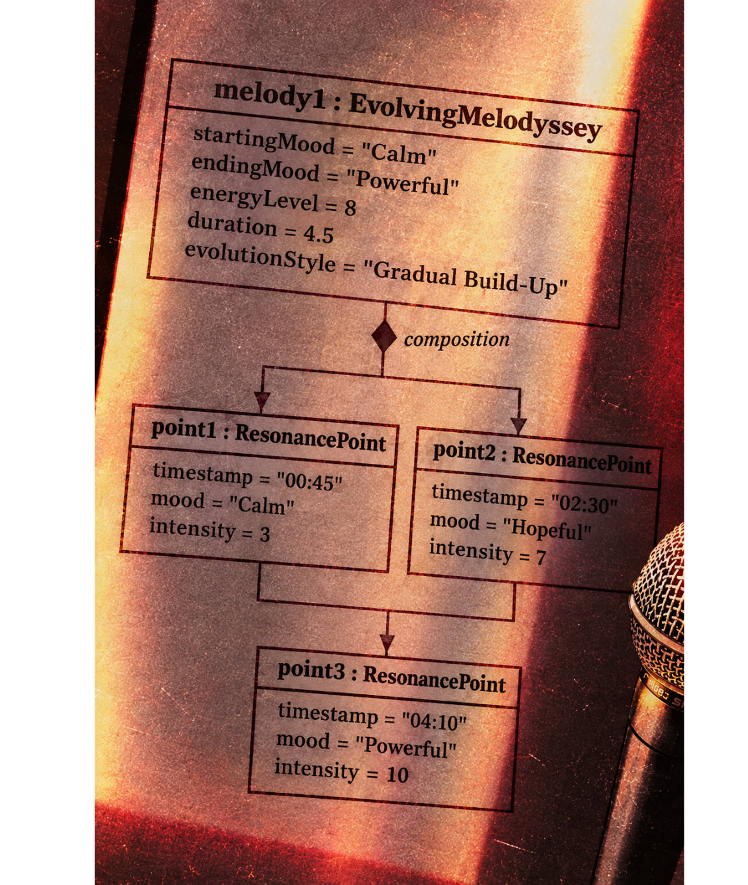

# Advanced Class Relationships

## Previous Activities

[Part I - Classes and Objects](classObjectUML.md)

[Part II - Class Attributes and Methods](classAttributesMethods.md)

[Part III - Class Relationships: Association and Multiplicity](classRelationships.md)

## Existing System Description:

**Melodyssey** represents the journey of a listener through a piece of music, focusing on how the music changes from its beginning to its ending. It describes musical characteristics such as mood, energy, tempo, and progression.

The system also includes **ResonancePoint**, which represents a specific moment or checkpoint in a musical journey. In Part III, Melodyssey was related to ResonancePoint through a HAS-A relationship.

## Inheritance Relationship

**Parent:** `Melodyssey`

**Child:** `EvolvingMelodyssey`

**Explanation:**
`EvolvingMelodyssey` is a specialized type of `Melodyssey` that focuses on how a musical journey develops over time. It inherits the common properties and methods of `Melodyssey` and adds its own `evolutionStyle` property. This creates an **IS-A** relationship because an `EvolvingMelodyssey` is a type of `Melodyssey`.

## Inheritance UML

## Composition/Aggregation

**Relationship:** `Melodyssey` HAS-A `ResonancePoint`

**Explanation:**
This relationship is **composition** because a `Melodyssey` creates and manages its own `ResonancePoint` objects. The resonance points are stored inside the `Melodyssey` object in a private list. One `Melodyssey` can contain zero or more `ResonancePoint` objects, giving a multiplicity of `1 : 0..*`.

## Advanced UML Diagram

## Python Implementation

[Source Code](advancedRelationships.py)

## Test Run

## Object Diagram

## Reflection

**Answers:**

1. **Why did you choose this inheritance relationship?**
   I chose `EvolvingMelodyssey` as the child class because it is still a type of `Melodyssey`. It focuses more specifically on how the music changes throughout the journey while adding `evolutionStyle` as its own property.

2. **How does inheritance help avoid repeating code?**
   Inheritance allows `EvolvingMelodyssey` to reuse the properties and methods already defined in `Melodyssey`. For example, it can use `displayJourney()` and `increaseEnergy()` without rewriting them. The `super().__init__()` also allows it to reuse the parent constructor.

3. **Why is the HAS-A relationship composition instead of aggregation?**
   The relationship is composition because `Melodyssey` creates and manages its own `ResonancePoint` objects. The resonance points are treated as parts of the musical journey and are stored inside the `Melodyssey` object.

4. **How is this different from the relationship in Part III?**
   In Part III, the relationship between `Melodyssey` and `ResonancePoint` was mainly identified as a HAS-A relationship. In Part IV, the relationship is implemented specifically as composition, showing stronger ownership between the two classes.

5. **How do these relationships help keep the system organized?**
   Inheritance keeps the common features of a musical journey inside `Melodyssey`, while `EvolvingMelodyssey` can add specialized features. Composition keeps the `ResonancePoint` objects organized as parts of a `Melodyssey`. These relationships also reduce repeated code and make the system easier to extend.
